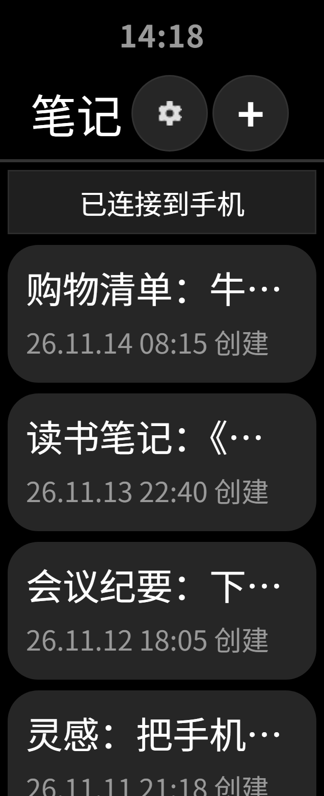
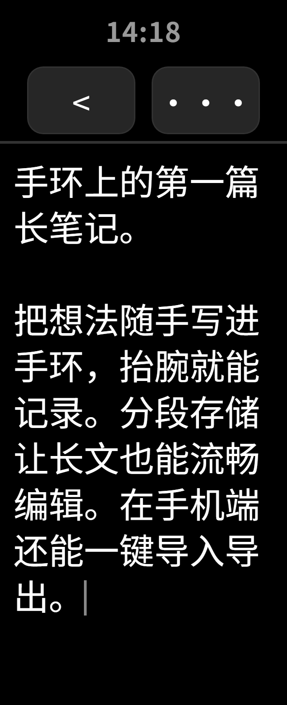
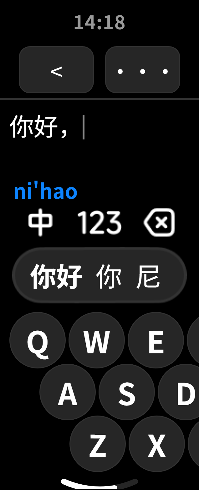
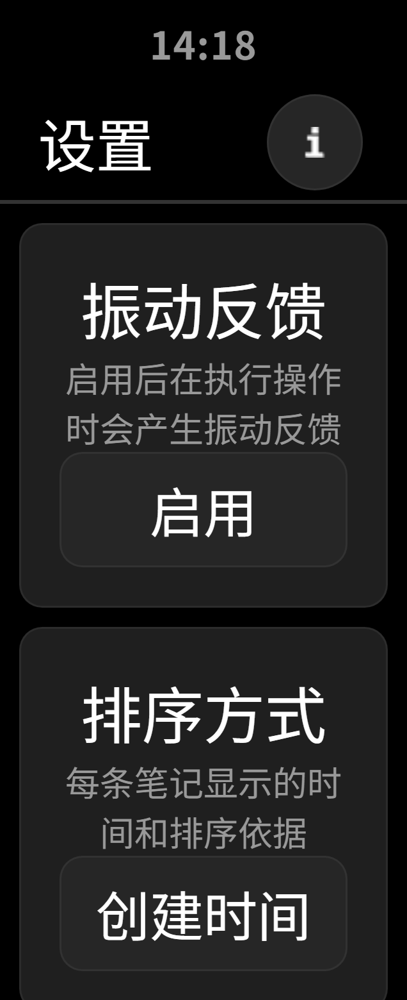

# 笔记本 · Notebook for Xiaomi Vela

为小米手环打造的腕上笔记本：在胶囊屏上完成新建、编辑、删除与长文管理，
并通过手机端笔记管理器与手环双向同步。

- 手环端：Vela 快应用（`.rpk`），包名 `com.zyz4.notebook`
- 手机端：Android 笔记管理器（`.apk`），包名与手环端一致
- 当前源码版本：**2.2.3**

> 本项目为个人开发的开源项目，与小米公司无隶属关系。

## 目录

- [功能特性](#功能特性)
- [预览](#预览)
- [兼容性](#兼容性)
- [目录结构](#目录结构)
- [构建](#构建)
- [实现要点](#实现要点)
- [设置项](#设置项)
- [第三方组件与许可](#第三方组件与许可)
- [开源协议](#开源协议)
- [反馈与贡献](#反馈与贡献)

## 功能特性

### 手环端

- **笔记管理**：列表、新建、编辑、删除，显示创建时间 / 修改时间，可切换排序依据。
- **腕上输入法**：26 键与 9 键（T9）两种布局，支持全拼与多种双拼方案：
  自然码、小鹤、微软、智能 ABC、拼音加加、四通。
- **词库**：收录 6763 个常用汉字，支持整词与首字母简拼；词库外置为资源文件按需读取，
  避免大体积 `.jsc` 在部分机型上加载失败。
- **长文分段存储**：按 UTF-8 字节切段，编辑器只加载当前窗口内的段，保存时流式重写，
  长笔记不再整篇驻留内存。
- **自动滚动**：编辑时按设置保留 0 / 1 / 2 行空白，减少输入遮挡。
- **恢复文件**：编辑中的内容会流式写入 `recovery.txt`，异常退出后可恢复未保存的笔记。
- **可调设置**：振动反馈、时间显示、自动滚动、键盘布局、边框宽度、分段长度。
- **手机互联**：通过 `@system.interconnect` 与 Android 端通信，支持协议 v2 分片同步。

### Android 端

- 通过小米穿戴 SDK 连接手环，连接前自动拉起手环应用，避免错过握手消息。
- 浏览手环笔记列表，新建 / 编辑 / 删除笔记，显示分片同步进度。
- 优先使用协议 v2（按字符区间读取、UTF-8 安全分片上写）；对手环旧版本自动回退到
  `request_full_note` / `update_note` / `create_note`。
- 本地镜像 `LocalNoteStore` 保存最近一次完整内容，用于兼容旧协议的反向请求与问题排查。

## 预览

<p align="center">
  
  
  
  
</p>

## 兼容性

| 部分 | 要求 / 说明 |
| --- | --- |
| 手环设备 | 小米手环 10 / 10 NFC、小米手环 11 / 11 NFC |
| 手环运行时 | Vela 快应用，`deviceTypeList: ["watch"]`，`minAPILevel: 2` |
| 手机端系统 | Android 10+（`minSdk 29`，`targetSdk 35`） |
| 通信方式 | 小米穿戴 SDK `xms-wearable-lib_1.4_release.aar` + `@system.interconnect` |

> 不同机型的发布包版本可能不同，请以对应版本的源码构建产物为准。

## 目录结构

```
notebook_app/
├─ src/                        手环端 Vela 快应用源码
│  ├─ index/                   笔记列表页（同时处理手机端协议）
│  ├─ edit/                    笔记编辑页
│  ├─ settings/                设置页
│  ├─ about/                   关于页
│  ├─ Common/
│  │  ├─ utils.js              设置、元数据、笔记文件读写
│  │  └─ textSegments.js       分段模型：扫描、按窗口加载、流式写入、导入
│  ├─ components/InputMethod/  输入法组件、键位方案、外置词库
│  └─ manifest.json            手环端清单（包名、页面、权限）
├─ android/                    手机端笔记管理器（Android / Gradle）
│  ├─ app/src/main/java/com/zyz4/notebook/
│  ├─ app/libs/                小米穿戴 SDK
│  └─ README.md                Android 端构建与协议说明
├─ docs/
│  ├─ segmented-transfer-v2.md 笔记同步协议 v2
│  └─ images/                  预览截图
├─ tools/
│  ├─ gen-dictionary.js        词库生成脚本
│  └─ dictionary-source/       旧版 JS 词库源
├─ sign/                       手环端签名证书（仅本地保留，不入库）
├─ dist/                       构建产物
└─ build.cmd                   手环端打包命令
```

## 构建

### 手环端（Vela 快应用）

环境：Node.js 18+、npm，以及项目依赖中的 `aiot-toolkit`。

```powershell
npm install
npm run build
# 等价于：npx aiot release --enable-jsc
```

打包产物输出到 `dist/`，例如：

```
dist/com.zyz4.notebook.release.2.2.3.rpk
```

> 签名材料（`sign/private.pem`、`sign/certificate.pem`）不在仓库中，
> 需要在本地 `sign/` 目录自行准备后才能打包；这些文件已被 `.gitignore` 忽略。

开发调试可使用 `.vscode/mcp.json` 中配置的 VelaJS MCP（设备选择、构建、截图、控制台日志等）。

### 词库

修改 `tools/dictionary-source/` 下的词库后，重新生成手环端资源：

```powershell
node tools/gen-dictionary.js
```

该脚本会把单字表、整词表和简拼索引输出为 `src/components/InputMethod/assets/dictionary/`
下的 `txt` 资源，并生成 `words-a.txt` … `words-z.txt` 分片。

### Android 端

环境：JDK 17+、Android SDK Platform 36、Build Tools 36.x。

```powershell
cd android
.\gradlew.bat assembleRelease
```

产物：

```
android/app/build/outputs/apk/release/app-release.apk
```

构建前请在 `android/local.properties` 中配置 `sdk.dir`。签名材料
（`android/keystore/notebook.p12` 与 `sign/private.pem`、`sign/certificate.pem`）
不随仓库提供，需要在本地自行生成或放置，详见
[`android/README.md`](android/README.md)。

## 实现要点

### 分段存储

```
internal://files/note_<id>.txt       纯 UTF-8 文本
internal://files/note_<id>.txt.idx   段表：固定 128 字节基准段，记录 byteLen / charLen
internal://files/metadata.json       笔记元数据（时间、预览等）
internal://files/settings.json       手环端设置
internal://files/recovery.txt        编辑中的恢复文件
```

- 索引固定按 **128 字节基准段**记录；设置中的 128 / 256 / 512 / 768 字节逻辑段
  由基准段合并得到，修改分段长度不会重扫全部笔记。
- 编辑器通过 `openDoc` / `loadRange` / `getRange` / `setWindow` 只保留窗口内的段，
  保存时用 `writeDocToUri` + `commitDoc` 流式重写。
- 手机端上传时先写入临时文件，`importTextFile` 成功后才替换正式笔记，失败不破坏原文件。

### 手机同步

协议 v2 采用「按字符区间读取 + UTF-8 安全分片上写」：

- 读取：`note_open` → `note_meta` → 循环 `note_read` / `note_chunk` → `note_close`
- 写入：`note_write_begin` → `note_write_chunk` / `note_write_ack` →
  `note_write_commit` → `note_write_success`
- 分片按 code point 切分，不会把代理对（emoji）劈开；手环按 `seq` 去重并校验字节数 / 字符数。

完整报文格式、兼容矩阵与错误处理见
[`docs/segmented-transfer-v2.md`](docs/segmented-transfer-v2.md)。

## 设置项

| 设置 | 可选值 | 默认值 |
| --- | --- | --- |
| 振动反馈 | 启用 / 禁用 | 启用 |
| 排序方式 | 创建时间 / 修改时间 | 创建时间 |
| 自动滚动 | 不留空 / 留空 1 行 / 留空 2 行 | 留空 1 行 |
| 键盘布局 | 9 键 / 26 键 | 26 键 |
| 边框宽度 | 0px / 10px / 20px | 10px |
| 分段长度 | 128 / 256 / 512 / 768 字节 | 256 字节 |

## 第三方组件与许可

本项目原创代码以 GPLv3 发布，但项目中涉及以下第三方内容，它们**不适用**本项目的
GPLv3 授权，请分别遵守其原始许可：

| 内容 | 来源 / 许可 |
| --- | --- |
| `android/app/libs/xms-wearable-lib_1.4_release.aar` | 小米穿戴 SDK，专有软件，版权归小米所有；再分发需遵守小米的 SDK 条款 |
| 小米 Vela 开发文档 | 页面标注 “© Xiaomi Vela all rights reserved”；仅作本地参考，已从仓库与历史中移除，**不得**按 GPLv3 再分发 |
| `src/components/InputMethod/assets/schema/*.js` | 双拼键位依据 [rime/rime-double-pinyin](https://github.com/rime/rime-double-pinyin)（GPL-3.0）整理 |
| AndroidX / Material Components | Apache License 2.0 |
| Gradle Wrapper | Apache License 2.0 |

> **注意**：Android APK 链接了专有的小米穿戴 SDK。虽然本仓库的原创源码采用 GPLv3，
> 但包含该 SDK 的 APK 在分发时仍需同时满足小米 SDK 的条款；如计划严格按 GPLv3
> 分发二进制，请先确认 SDK 授权或将其从分发物中剥离。

## 开源协议

本项目（除上述第三方内容外）采用 **GNU General Public License v3.0 or later**
（GPL-3.0-or-later）发布，完整协议文本见 [LICENSE](LICENSE)。

```
Copyright (C) 2025-2026 4zyz4

This program is free software: you can redistribute it and/or modify
it under the terms of the GNU General Public License as published by
the Free Software Foundation, either version 3 of the License, or
(at your option) any later version.

This program is distributed in the hope that it will be useful,
but WITHOUT ANY WARRANTY; without even the implied warranty of
MERCHANTABILITY or FITNESS FOR A PARTICULAR PURPOSE.  See the
GNU General Public License for more details.

You should have received a copy of the GNU General Public License
along with this program.  If not, see <https://www.gnu.org/licenses/>.
```

简单来说：你可以自由使用、修改和分发本项目，但分发修改版或衍生作品时，
必须以 GPLv3 兼容的方式公开源代码，并保留版权与许可声明。

## 反馈与贡献

- 问题与建议：GitHub [Issues](https://github.com/4zyz4/notebook-vela/issues)
- 米坛帖子：<https://www.bandbbs.cn/threads/26699/>
- QQ 群：780301769
- 欢迎提交 Pull Request；提交前请确保手环端 `npm run build` 与 Android 端
  `gradlew assembleRelease` 均可通过。

## 免责声明

本项目为非官方作品，与小米公司无关。安装、刷机或使用本软件产生的任何风险由使用者自行承担；
作者不对数据丢失、设备故障或其他损失负责。GPLv3 第 15、16 条已明确本软件不提供任何担保。
